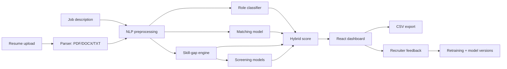

# AI Resume Screening System

[](https://github.com/Anjalidubey2/resume-screening-ml/actions/workflows/tests.yml)

Upload resumes and a job description — the system ranks every candidate out of 100, explains the score with matched and missing skills, and learns from recruiter feedback.

Built with **Python, scikit-learn, FastAPI and React**.

> Based on [Dibya-del/resume-screening-ml](https://github.com/Dibya-del/resume-screening-ml), extended and fixed by **[Your Name]** as a college major project — see [What I improved](#what-i-improved).

<!-- Add screenshots to docs/screenshots/ and uncomment:

-->

## Features

- Upload **PDF, DOCX and TXT** resumes (many at once)
- **Ranks candidates** with a hybrid score from three ML models and a skill engine
- **Matched / missing skill** chips, pie and bar charts, highlighted resume preview
- Labels showing whether each score came from an **ML model or a backup formula**
- Filter by minimum score or by skill; **export rankings to CSV**
- Recruiter **feedback** buttons, model **snapshots** and one-click **retraining**
- Interactive API docs (Swagger) at `/docs`; dark / light mode

## How it works

Four "judges" score every resume:

| Judge | Question | Method | Weight |
|---|---|---|---|
| Matching model | Does this resume fit this job? | Character TF-IDF pair features + Logistic Regression | 35% |
| Skill engine | Which required skills are present? | 65 skills with synonyms, whole-word matching | 25% |
| Screening model | Is this a strong candidate *for this job*? | Logistic Regression (hire probability) + Random Forest (AI score 0–100), **× skill match** | 25% |
| Role classifier | Is this person from a field that suits the job? | Word TF-IDF + calibrated Linear SVM, 24 categories; only job-relevant fields count | 15% |

Two adjustments keep unrelated profiles from scoring high: the screening model judges overall strength (experience, education) but never saw people applying outside their field, so its score is **multiplied by skill match**; and the role judge only counts fields that suit the job (IT / engineering for tech roles), so being confidently "HR" does not help for a data-science job.

**Fit levels:** 85–100 Strong · 70–84 Good · 55–69 Moderate · 0–54 Weak



## Quick start (Windows)

Requirements: **Python 3.11** and **Node.js 18+**.

1. Double-click **`setup.bat`** — creates the Python environment, installs everything and checks the models.
2. Double-click **`run_all.bat`** — starts the backend and frontend and opens http://127.0.0.1:5173.
3. Upload resumes from `data/samples/resumes/` and click **Screen resumes**.

Manual commands (any OS):

```bash
cd backend
python -m venv venv
venv\Scripts\python -m pip install -r requirements-dev.txt      # macOS/Linux: venv/bin/python
venv\Scripts\python check_models.py
venv\Scripts\python -m uvicorn main:app --host 127.0.0.1 --port 8000

cd ../frontend
npm install
npm run dev
```

## Datasets and retraining

| # | Dataset | Used for | Get it |
|---|---|---|---|
| 1 | Resume Dataset (~2,400 resumes, 24 categories) | Role classifier | [Kaggle](https://www.kaggle.com/datasets/snehaanbhawal/resume-dataset) → `data/raw/dataset_1_resumes/Resume.csv` |
| 2 | Resume–Job Description Fit (8,000 English pairs) | Matching model | Downloaded automatically from [Hugging Face](https://huggingface.co/datasets/cnamuangtoun/resume-job-description-fit) |
| 3 | AI-Powered Resume Screening Dataset 2025 | Screening models | [Kaggle](https://www.kaggle.com/datasets/mdtalhask/ai-powered-resume-screening-dataset-2025) → `data/raw/dataset_3_ai_screening/AI_Resume_Screening.csv` |

Then double-click **`retrain_models.bat`**. It downloads dataset 2, cleans all datasets, **backs up the current models**, retrains every model whose data is present, writes metrics to `outputs/`, and checks the new models. Restart the backend afterwards.

**No Windows PC needed:** on GitHub open **Actions → Retrain matcher (English) → Run workflow**. GitHub downloads dataset 2, retrains the matching model, runs every test, and saves the new model to the repository only if all tests pass (Render then redeploys automatically).

Charts and metrics: `notebooks/01_data_exploration.ipynb` and `notebooks/02_model_evaluation.ipynb`.

## Results

| Model | Metric | Result |
|---|---|---|
| Role classifier | Test accuracy / macro F1 | [fill from `outputs/role_classifier_metrics.csv`] |
| Matching model (after English retraining) | Accuracy / F1 / ROC-AUC | [fill from `outputs/matching_model_metrics.csv`] |
| Screening decision | Accuracy / F1 / ROC-AUC | [fill from `outputs/screening_model_metrics.csv`] |
| AI score regressor | MAE / R² | [fill from `outputs/screening_model_metrics.csv`] |

## Testing

```bash
cd backend
venv\Scripts\python -m pytest          # unit, model and API tests
venv\Scripts\python check_models.py    # confirms every ML model loads and predicts
```

Every upload to GitHub also runs all tests — including the ML-model and ranking tests — on GitHub Actions (badge at the top).

## What I improved

| Problem in the original | Fix |
|---|---|
| Models were trained with scikit-learn 1.8 / NumPy 2 but `requirements.txt` installed 1.3 / 1.26, so **every ML model silently failed** and backup formulas were used | Corrected versions; added `check_models.py`; the UI now labels any backup-formula score |
| Text was preprocessed differently at prediction time than during training | Preprocessing locked to the training configuration |
| Matching model learned from **Russian** text but screens English resumes | Added a pipeline that retrains it on 8,000 English resume–job pairs (`retrain_models.bat`) |
| Screening model received a job role it had never seen (e.g. "information technology") | Role now inferred from the job description (`job_roles.py`) |
| False skill matches ("security", "iOS", "Ann", "spring", "lambda") and missing skills (SIEM, MLOps, testing, REST APIs) | Skill dictionary cleaned and extended |
| ~20 MB of models reloaded for every resume | Models load once per server start |
| CSV export saved only on the server; launch scripts used another PC's paths | Browser download; portable `setup` / `run` / `retrain` scripts |
| Layout scrolled sideways on projector screens; empty-filter message was misleading | Responsive breakpoint and clearer messages |
| The hybrid score ranked an **HR manager #2 for a Data Scientist job** (the screening model rewarded years of experience; the role judge rewarded being confidently *any* field) | Screening score × skill match; role judge counts only job-relevant fields. Tested on 4 jobs × 8 resumes |
| ML tests could not run on a Windows PC with Smart App Control | GitHub Actions runs every test (incl. ML and ranking tests) on each upload, plus a one-click retraining workflow |
| No tests, notebooks or documentation | pytest suite, two notebooks, report, viva guide, demo script, sample resumes |

## Project structure

```text
├── backend/
│   ├── api/                 # FastAPI routes and request/response schemas
│   ├── services/            # parser, preprocessing, skills, models, recommender, training
│   ├── tests/               # pytest suite
│   ├── check_models.py      # model health check
│   ├── main.py              # FastAPI app
│   ├── requirements.txt
│   └── requirements-dev.txt
├── frontend/src/            # React dashboard (App.jsx, api.js, styles.css)
├── models/                  # trained model files (.pkl)
├── data/
│   ├── raw/job_descriptions/
│   └── samples/resumes/     # 8 fictional demo resumes
├── notebooks/               # data exploration and model evaluation
├── docs/                    # project report, viva Q&A, demo script
├── outputs/                 # model metrics after training
├── setup.bat  run_all.bat  run_backend.bat  run_frontend.bat  retrain_models.bat
```

## API

Swagger docs: http://127.0.0.1:8000/docs

```text
GET  /health                     POST /api/recommend-upload       POST /api/recommend
POST /api/parse-resume           POST /api/predict-role           POST /api/predict-match
POST /api/analyze-skills         POST /api/screen-candidate       POST /api/evaluate-ranking
POST /api/export-rankings        POST /api/feedback               GET  /api/model-status
POST /api/create-model-version   POST /api/retrain
```

## Deployment

Step-by-step guide: **[docs/DEPLOYMENT.md](docs/DEPLOYMENT.md)** (free, about 40 minutes).

- **Backend → Render (Free plan):** root directory empty (the models are outside `backend/`), build `pip install -r backend/requirements.txt`, start `uvicorn --app-dir backend main:app --host 0.0.0.0 --port $PORT`, env `PYTHON_VERSION=3.11.11` and `BACKEND_CORS_ORIGINS=<your frontend URL>` (see `render.yaml`).
- **Frontend → Vercel:** root `frontend`, env `VITE_API_BASE=<your Render URL>`.

The free backend sleeps after 15 idle minutes (about 1 minute to wake — the dashboard keeps retrying automatically). Feedback, exports and snapshots are local files, so they reset when it restarts.

## Limitations and future scope

- The skill engine only knows its 65 skills; scanned (image-only) PDFs are not read.
- Dataset 3 appears computer-generated, so screening accuracy would be lower on real hiring data.
- Models trained on past decisions can repeat past bias — the tool supports a human decision, it doesn't replace it.
- Next steps: BERT sentence embeddings, automatic retraining from validated feedback, a database, login, OCR, fairness checks.

## Documentation

- [Project report](docs/PROJECT_REPORT.md)
- [Viva questions & answers](docs/VIVA_QA.md)
- [Live demo script](docs/DEMO_SCRIPT.md)
- [Deployment guide](docs/DEPLOYMENT.md)

## Credits

- Original project: [Dibya-del/resume-screening-ml](https://github.com/Dibya-del/resume-screening-ml)
- Datasets: Kaggle (snehaanbhawal, mdtalhask) and Hugging Face (cnamuangtoun) — see links above.
