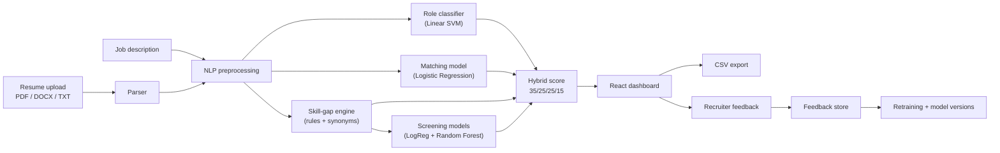

# AI Resume Screening System — Project Report

> Fill in the `[brackets]` before submitting. Replace the result tables in section 12 with the numbers from your own training run (`outputs/*_metrics.csv`, created by `retrain_models.bat`).

| | |
|---|---|
| **Student** | [Your name], [Roll number] |
| **Guide** | [Guide's name] |
| **Department / College** | [Department], [College] |
| **Academic year** | [2026–27] |

---

## 1. Abstract

Recruiters often receive hundreds of resumes for a single opening, and reading each one by hand is slow and inconsistent. This project is a web application that screens resumes automatically. A recruiter uploads resumes (PDF, DOCX or TXT) and a job description; the system extracts the text, cleans it with Natural Language Processing (NLP), and scores each candidate with three machine-learning models — a **role classifier**, a **resume–job matching model** and a **screening model** — plus a rule-based **skill-gap engine**. The four scores are combined into one weighted **hybrid score out of 100**, candidates are ranked, and matched and missing skills are shown visually. Recruiters can filter results, export them to CSV, and give feedback that is stored for future retraining. The system is built with Python, scikit-learn, FastAPI and React.

## 2. Introduction

Applicant screening is the first and most repetitive stage of hiring. Simple keyword filters miss synonyms ("sklearn" vs "scikit-learn") and cannot judge overall fit. Machine learning can learn patterns from past examples — which resumes belong to which field, which resume–job pairs were judged a fit, and which candidate profiles were hired — and apply them consistently in seconds.

## 3. Problem statement

Design and build a system that, given a job description and a set of resumes in common file formats, automatically **ranks the candidates by suitability**, **explains the ranking** through matched and missing skills, and **supports recruiter feedback**, while staying transparent about how each score was produced.

## 4. Objectives

1. Extract clean text from PDF, DOCX and TXT resumes.
2. Predict the professional field of each resume (role classification).
3. Predict how well a resume matches a job description (matching).
4. Predict a hire/reject decision and a 0–100 suitability score (screening).
5. Detect skills, including synonyms, and report the skill gap.
6. Combine all signals into one explainable ranking score.
7. Provide a simple web dashboard with charts, filters, CSV export and feedback.
8. Measure model quality with standard metrics and automated tests.

## 5. Existing system vs proposed system

| Existing (manual / keyword ATS) | Proposed system |
|---|---|
| Recruiter reads every resume | Ranked shortlist in seconds |
| Exact keyword matching only | Synonym-aware skill engine + ML models |
| No explanation of a rejection | Matched / missing skills shown for every candidate |
| Judgement varies between recruiters | Same scoring rules applied to every resume |
| Feedback is not captured | Feedback stored for retraining |

## 6. System architecture



**Request flow:** the React frontend sends the file and job description to the FastAPI backend (`POST /api/recommend-upload`). The backend parses the file, runs the four scorers, combines them, and returns JSON that the dashboard draws as a result card.

## 7. Modules

| Module | File | Purpose |
|---|---|---|
| Resume parser | `backend/services/parser.py` | Reads PDF (pdfminer), DOCX (python-docx) and TXT; rejects empty, oversized (>10 MB) or unsupported files |
| Preprocessing | `backend/services/preprocessing.py` | Lower-cases, removes emails/phones/URLs, normalises tech tokens (C++ → cplusplus), removes stop-words |
| Skill engine | `backend/services/skills.py` | ~65 skills with synonyms, whole-word matching, skill-gap score |
| Role classifier | `backend/services/model.py` | Predicts 1 of 24 job categories |
| Matching model | `backend/services/matching_model.py` | Probability that a resume fits a job |
| Screening models | `backend/services/screening_model.py` | Hire/Reject probability and AI score (0–100) |
| Job-role mapper | `backend/services/job_roles.py` | Maps the job description to a role the screening model knows, and scores whether a resume's field suits that job |
| Hybrid recommender | `backend/services/recommender.py` | Combines all scores, records which model produced each one |
| Ranking evaluation | `backend/services/evaluation.py` | MAP and NDCG ranking metrics |
| Feedback & versions | `feedback_store.py`, `model_registry.py`, `retraining.py` | Stores feedback, snapshots models |
| API | `backend/api/routes.py` | 13 REST endpoints, Swagger docs at `/docs` |
| Dashboard | `frontend/src/App.jsx` | Upload, results, charts, filters, export, feedback |

## 8. Datasets

| # | Dataset | Size | Used for |
|---|---|---|---|
| 1 | Resume Dataset (Kaggle, snehaanbhawal) | ~2,400 resumes, 24 categories | Role classifier |
| 2 | Resume–Job Description Fit (Hugging Face, cnamuangtoun) | 8,000 English pairs: Good / Potential / No Fit | Matching model |
| 3 | AI-Powered Resume Screening Dataset 2025 (Kaggle) | Candidate profiles with recruiter decision and AI score | Screening models |

The original project trained the matcher on a large Russian-language dataset. Because this system screens English resumes, a pipeline was added to retrain the matcher on the English dataset 2 (see section 13).

## 9. Methodology

### 9.1 Text preprocessing
1. Remove URLs, e-mail addresses and phone numbers (privacy and noise).
2. Lower-case; protect tech tokens (`C++`, `C#`, `.NET`, `Node.js`) before punctuation is removed.
3. Remove 21 very common stop-words ("the", "and", "of"…).

### 9.2 TF-IDF features
TF-IDF turns text into numbers. **TF** (term frequency) counts how often a word appears in a document; **IDF** (inverse document frequency) lowers the weight of words that appear in almost every document. A word that is frequent in *this* resume but rare overall gets a high score.

### 9.3 Models

| Model | Input features | Algorithm | Why this algorithm |
|---|---|---|---|
| Role classifier | Word TF-IDF (1–2 word phrases, 25,000 features) | Linear SVM, calibrated to give probabilities | Fast and accurate on high-dimensional sparse text |
| Matching model | Character TF-IDF (3–5 letter pieces) of resume and job; cosine similarity, length features, absolute difference and element-wise product | Logistic Regression (balanced classes) | Gives a probability; robust to spelling variants |
| Screening decision | TF-IDF of skills + one-hot education/role + scaled experience/projects | Logistic Regression | Interpretable, gives hire probability |
| AI score | Same features | Random Forest Regressor (300 trees) | Captures non-linear patterns for a 0–100 score |

### 9.4 Hybrid score

```
final = 35 × match probability + 25 × skill match + 25 × (AI score / 100 × skill match) + 15 × role relevance
```

Two adjustments came from testing the live system, where an HR manager ranked second for a Data Scientist job:

- **AI score × skill match.** The screening models judge overall candidate strength (experience, education, certifications) but were trained only on people applying for jobs in their own field. Multiplying by skill match means a strong candidate only scores high when they also have the job's skills.
- **Role relevance.** Instead of the classifier's confidence in *any* field, only the probability of fields that suit the job counts (information technology and engineering for the four tech roles). Being confidently "HR" no longer helps for a data-science job.

With both changes, the matching candidate ranks first for each of the four sample job descriptions and the non-technical profiles rank in the bottom half.

| Score | Fit level |
|---|---|
| 85–100 | Strong Fit |
| 70–84 | Good Fit |
| 55–69 | Moderate Fit |
| 0–54 | Weak Fit |

If a model cannot be loaded, a simple backup formula is used for that part and the dashboard **labels it as "backup formula"** so the result is never silently misleading.

### 9.5 Ranking metrics
- **MAP (Mean Average Precision):** are the relevant candidates near the top of the list?
- **NDCG (Normalized Discounted Cumulative Gain):** like MAP, but rewards putting the *most* relevant candidates first.

## 10. Implementation

| Layer | Technology |
|---|---|
| Frontend | React 18, Vite 5 |
| Backend | Python 3.11, FastAPI, Uvicorn |
| Machine learning | scikit-learn 1.8, pandas, NumPy, SciPy |
| File parsing | pdfminer.six, python-docx |
| Testing | pytest, FastAPI TestClient |
| Analysis | Jupyter notebooks, matplotlib |

## 11. Testing

| Test type | What is checked | Where |
|---|---|---|
| Unit tests | Skill extraction and false positives, text cleaning, job-role mapping, MAP/NDCG, file parsing, feedback/CSV storage, dataset preparation | `backend/tests/` (`pytest`) |
| Model tests | Every model loads and predicts; results come from ML not backup formulas; for each of 4 jobs the matching sample resume ranks first and non-technical profiles rank in the bottom half | `backend/tests/test_models.py`, `backend/check_models.py` |
| Continuous integration | All tests above, the model check and the frontend build run on every upload, on GitHub's Linux servers | `.github/workflows/tests.yml` |
| API tests | Health check, upload and scoring, rejection of unsupported files | `backend/tests/test_api.py` |
| UI tests | Upload, ranking, highlighting, filters, CSV export, feedback, dark mode, error message, projector-width layout | Manual run in the browser |

## 12. Results

> Replace this table with your own numbers from `outputs/role_classifier_metrics.csv`, `outputs/matching_model_metrics.csv` and `outputs/screening_model_metrics.csv`. Charts are in `notebooks/02_model_evaluation.ipynb`.

| Model | Metric | Original project (reported) | This project (your run) |
|---|---|---|---|
| Role classifier | Test accuracy / macro F1 | 71.43% / 67.07% | [ ] |
| Matching model | Accuracy / F1 / ROC-AUC | 67.30% / 67.41% / 73.31% (Russian data) | [ ] (English data) |
| Screening decision | Accuracy / F1 / ROC-AUC | 94.00% / 96.15% / 99.85% | [ ] |
| AI score regressor | MAE / R² | 2.62 / 96.56% | [ ] |

## 13. Improvements made in this project

1. **Fixed library versions** — the trained models needed scikit-learn 1.8 and NumPy 2, but the project installed 1.3 and 1.26, so the ML silently failed and backup formulas were used.
2. **Fixed a training/prediction mismatch** in text preprocessing.
3. **English matching pipeline** — code to download, clean and retrain the matcher on English resume–job pairs instead of Russian ones (`retrain_models.bat`).
4. **Correct input to the screening model** — the job role now comes from the job description, not from a 24-category guess the model had never seen.
5. **Transparency** — every result shows whether each score came from an ML model or a backup formula.
6. **Better skill detection** — removed false positives ("security", "iOS", "Ann", "spring") and added missing skills (SIEM, MLOps, testing, REST APIs).
7. **Speed** — models load once instead of on every request.
8. **Usability** — CSV now downloads in the browser, synonym highlighting, clearer empty-filter message, layout fixed for projector screens.
9. **Engineering** — automated tests, one-click setup / run / retrain scripts, notebooks, model backups before retraining.
10. **Fairer hybrid score** — live testing showed an HR manager ranked second for a Data Scientist job; the screening score is now multiplied by skill match and the role judge counts only job-relevant fields (section 9.4).
11. **Continuous integration and cloud retraining** — GitHub Actions runs every test on each upload and retrains the matcher with one click, saving the new model only if all tests pass.

## 14. Limitations

- The skill engine only knows the skills in its list.
- Dataset 3 appears computer-generated, so the very high screening accuracy would likely be lower on real hiring data.
- Scanned (image-only) PDFs are not read, because there is no OCR.
- Models trained on past hiring decisions can repeat past bias; the system supports, but must not replace, a human decision.

## 15. Future scope

- Sentence-embedding models (e.g. BERT) for deeper semantic matching.
- Full automatic retraining from validated recruiter feedback.
- A database instead of CSV files; login for recruiters.
- Fairness checks (e.g. comparing score distributions across groups).
- OCR for scanned resumes.

## 16. Conclusion

The system turns a slow manual task into an automated, explainable ranking. Combining three ML models with a transparent skill engine gives recruiters both a score and the reasons behind it, and the feedback loop lets the system keep improving.

## 17. References

1. Pedregosa et al., "Scikit-learn: Machine Learning in Python", *JMLR* 12, 2011.
2. Järvelin, K. & Kekäläinen, J., "Cumulated gain-based evaluation of IR techniques", *ACM TOIS* 20(4), 2002 (NDCG).
3. Manning, Raghavan & Schütze, *Introduction to Information Retrieval*, Cambridge University Press, 2008 (TF-IDF, MAP).
4. FastAPI documentation — https://fastapi.tiangolo.com
5. React documentation — https://react.dev
6. Resume Dataset — https://www.kaggle.com/datasets/snehaanbhawal/resume-dataset
7. Resume–Job Description Fit — https://huggingface.co/datasets/cnamuangtoun/resume-job-description-fit
8. AI-Powered Resume Screening Dataset 2025 — https://www.kaggle.com/datasets/mdtalhask/ai-powered-resume-screening-dataset-2025
9. Original project this work builds on — https://github.com/Dibya-del/resume-screening-ml
